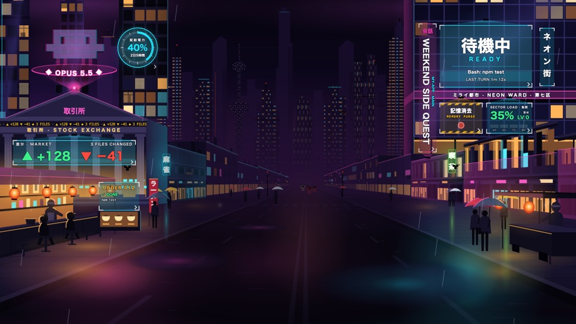
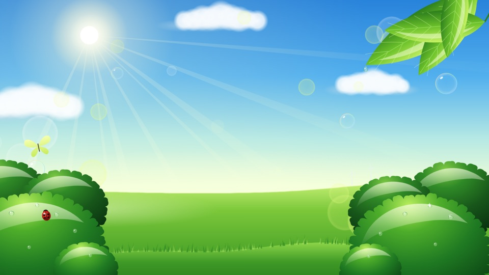
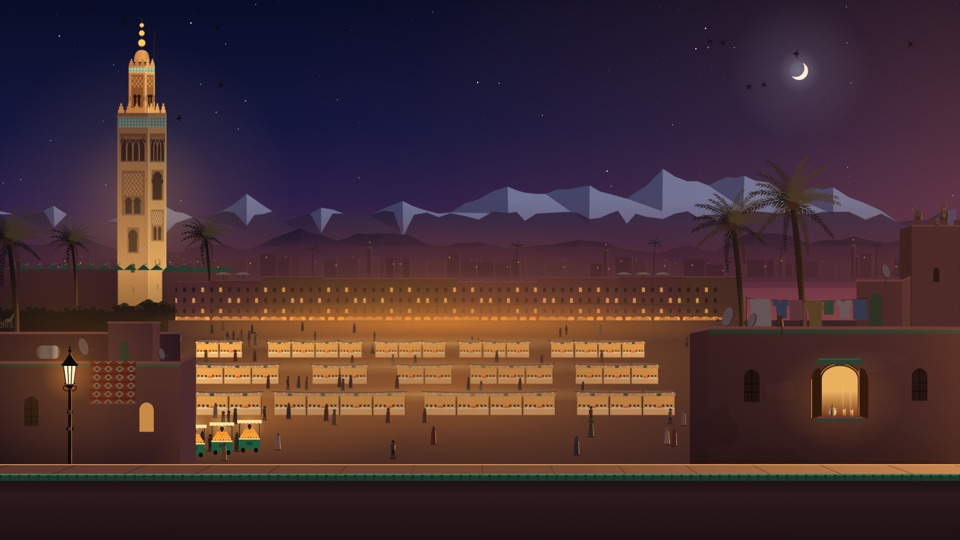
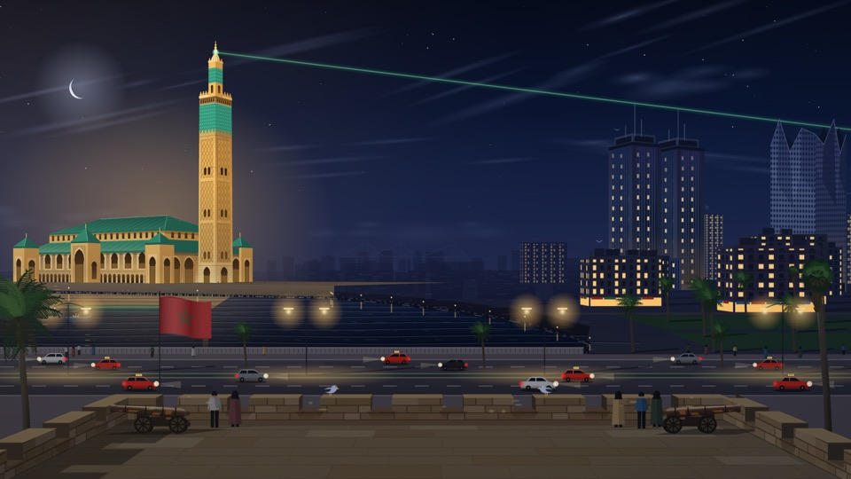
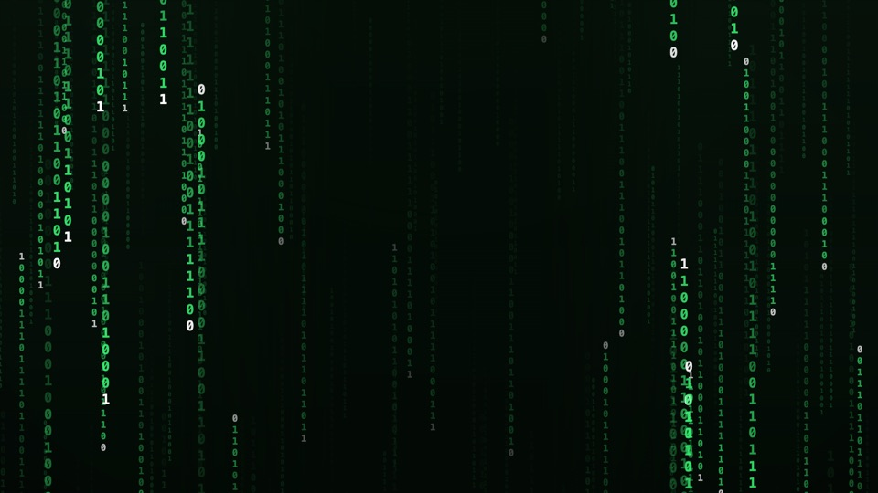
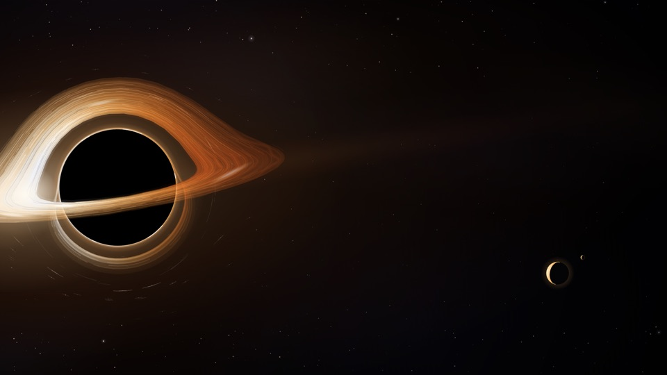
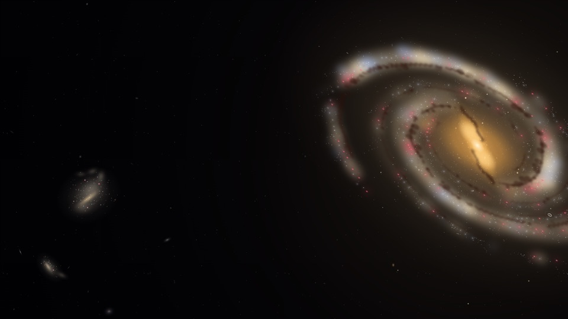
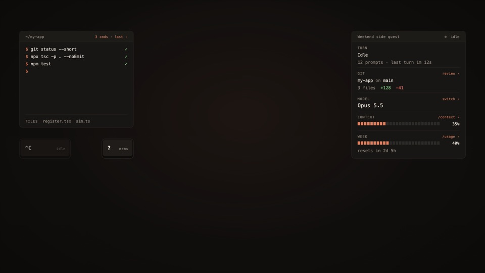
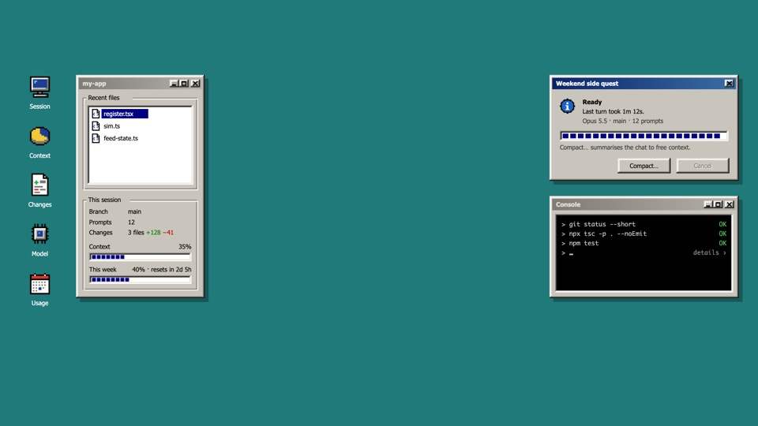
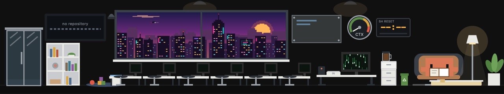

# PimpMyClawd 🦀✨

Mods that dress up Claude. Animated backdrops, a tiny crab with a staff of helpers, and buttons in the scenery that actually do things.



## What's in the box 📦

| Mod | What it does |
|---|---|
| 🎨 **looks** | 30 animated skins for the Claude desktop and mobile apps, switched with `/skin` |
| 🦀 **clawd** | Clawd moves in above your prompt and gets busy whenever Claude does |

## Install ⚡

Run these in Claude Code:

```text
/plugin install looks --marketplace Amerruki/PimpMyClawd
/plugin install clawd --marketplace Amerruki/PimpMyClawd
```

Take one or both, they get along fine.

## 🎨 looks

Each skin is a full makeover: an animated scene behind the chat plus a matching colour palette, with a day and a night version.

| | | |
|---|---|---|
| <br>**Aero** 🫧 | <br>**Aero Aqua** 🧴 | <br>**Aero Eco** 🌿 |
| <br>**Marrakech** 🕌 | <br>**Casablanca** 🌊 | <br>**Y2K** 💿 |
| <br>**Matrix** 🟩 | <br>**Black hole** 🕳️ | <br>**Milky Way** 🌌 |
| <br>**Terminal** ⌨️ | <br>**Retro** 💾 | <br>**Cyberpunk** 🌃 |

### All 30 skins

- 🫧 **Aero:** `aero`, `aero-aqua`, `aero-eco`, `aero-city`, `aero-dark`, `aero-aurora`, `aero-zen`
- 🌃 **Cyberpunk:** `cyberpunk`
- 💾 **Retro:** `retro`, `terminal`
- 🟩 **Matrix:** `matrix`, `matrix-orange`, `matrix-magenta`, `matrix-cyan`
- 💿 **Y2K:** `y2k`
- 🪐 **Space:** `space-orrery`, `space-venus`, `space-earth`, `space-mars`, `space-jupiter`, `space-saturn`, `space-uranus`, `space-neptune`, `space-nebula`, `space-galaxy`, `space-deepfield`, `space-blackhole`
- 🇲🇦 **Morocco:** `marrakech`, `casablanca`, `riad`

### Commands

| Command | What happens |
|---|---|
| `/skin` | Lists every skin, with a `*` next to the one you're on |
| `/skin aero` | Switches skin. Two words work too: `/skin matrix orange` |
| `/skin marrakech dark` | Pins the night version (`light` for day, `auto` to follow your app) |
| `/skin dark` | Flips the skin you're on to night |
| `/skin off` | Back to the app's own theme |
| `/skin help` | All of the above, in the app |

### Live skins 👀

**Terminal**, **Retro** and **Cyberpunk** watch your session and show it in the scene: what Claude is doing, your last commands, git changes, how full the context window is and when your weekly limit resets. Cyberpunk even shutters the street and sends out the police while a conversation gets compacted 🚨

Their panels are clickable too. Tap the context meter for `/context`, the model panel to switch models, the git panel for a diff summary. Big moves like compacting ask you to tap twice, right there in the scene.

Want to see every state without waiting for it? `/skin sim` fakes them:

```text
/skin sim working context 85
/skin sim compacting
/skin sim off
```

### Good to know 💡

- Skins show in the desktop and mobile apps. The terminal keeps its own look.
- On desktop, pinning `dark` or `light` changes the scene, and the chat colours keep following your app's own setting.
- The app pauses any backdrop that gets too heavy or too flashy, and shows it as a still picture. Aero Dark and Aero Aurora are in that club for now.

## 🦀 clawd



Clawd gets his own little office above your prompt. When Claude thinks, he thinks. When Claude runs tools, he scuttles off on errands. Big jobs bring in a crew of helpers with laptops, and git commits, pushes and merges each get their own trip. The city outside follows your time of day, the weather changes, and the gauge on the wall fills up with your context.

| Command | What happens |
|---|---|
| `/clawd` | Shows or hides him |
| `/clawd tour` | Every animation in about four minutes (`/clawd stop` ends it) |
| `/clawd helpers 8` | Calls in the crew, up to 12 |
| `/clawd time 21` | Sets the hour outside the window (`auto` follows your clock) |

There's plenty more where that came from: `/clawd help` lists it all.

## License

MIT 🧡
